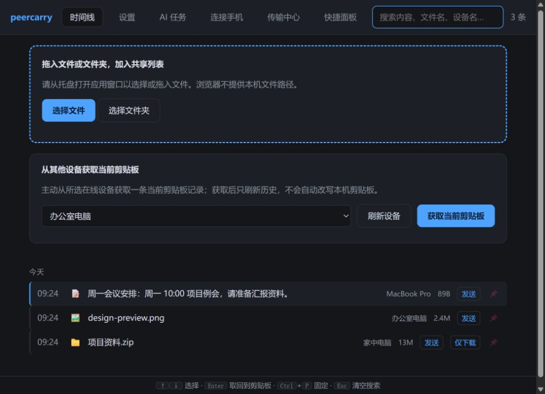
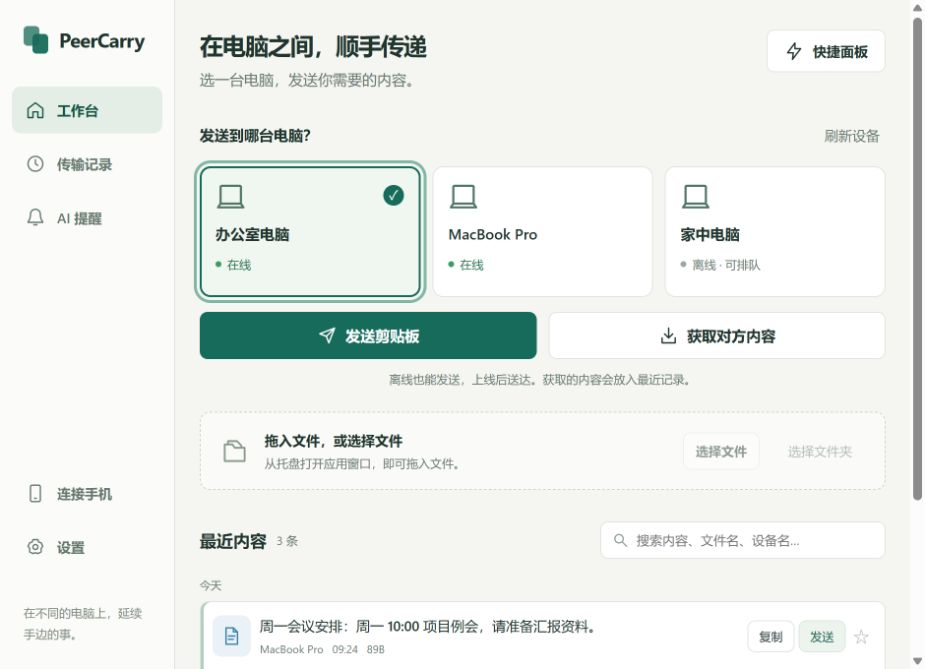
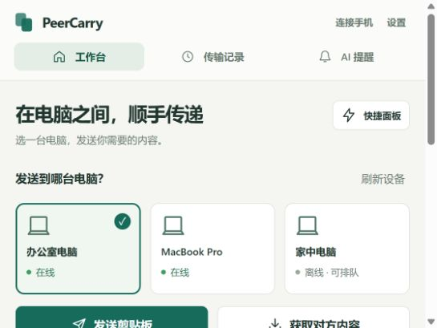
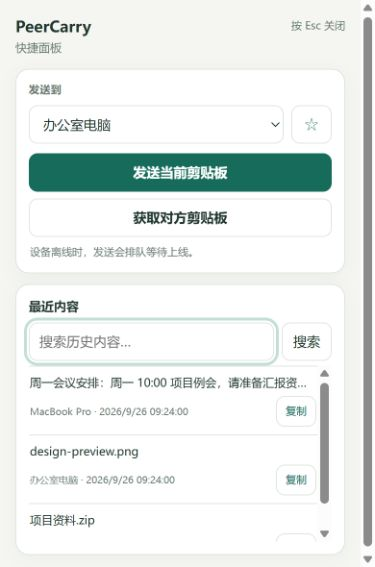
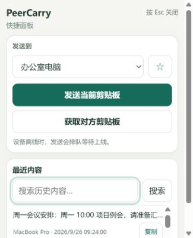

# 界面检测与对比（2026-09-26）

结论：主要视觉方向已落实，四项功能入口与已覆盖的行为回归通过；当前界面仍有首屏密度问题，快捷面板有两处可复现的刷新问题，不能据此宣布完整实机验收通过。本轮只检查并记录，没有修改产品源码。

## 对比方法

- 视觉参考：`imagegen-concept.png`。
- 改版前：`target/interface-before/timeline.html`；改版后：当前 `crates/peercarry-core/timeline.html`、`quick.html`。
- 使用相同的三台模拟电脑及文本、图片、文件三条模拟记录，分别检查 940×680、560×420、390×590、340×420。
- 截图使用只读本地样本服务，强制执行中文文案分支，未改变用户浏览器语言。其他 HTML/CSS/JavaScript 来自当前文件。该服务拒绝发送、复制等写操作，不读取实际剪贴板，也不连接真实电脑。
- 该样本用于比较布局与文案，不证明真实发送、原生文件选择、托盘热键或安装版行为。

## 需要优先调整

| 优先级 | 问题 | 已验证证据 | 建议 |
| --- | --- | --- | --- |
| 中 | 主工作台首屏密度下降 | 同为 940×680，旧版三条记录位于 y=486–612，均在首屏；新版第一条位于 y=611–681，后两条结束于 y=751、821，需滚动。560×420 时发送按钮顶部为 y=392，不能完整显示，历史标题在 y=605。 | 根据窗口高度收紧标题、设备卡片与区块间距；短窗口改为紧凑设备选择，保证主按钮完整可见，并尽量显示 2–3 条最近内容。 |
| 中 | 获取成功后的历史刷新错误被覆盖 | `quick.html:81` 执行 `await search(); status(t.fetched)`；`search()` 在第 91 行吞掉错误。VM 模拟获取成功、随后 timeline 返回 503，最终仍显示“已加入本机历史，剪贴板未更改”，列表刷新失败提示消失。 | 分别表达“获取成功”与“列表刷新失败”，让搜索返回结果或传播异常，保留重试入口。此问题不等同于获取接口失败或内容丢失。 |
| 中 | 忙碌时重新打开快捷面板会丢弃刷新 | 原生托盘 `main.rs:204` 调用 `window.quickPanelRefresh()`；`quick.html:97` 在忙碌时直接返回。VM 将发送保持 pending，再调用重开钩子，peer/timeline 请求各仍为 1 次，搜索框未重新聚焦；发送结束也没有补刷。 | 记录一次待执行刷新，在当前操作完成后更新设备、历史与焦点，保留防重复发送保护。 |
| 低 | 快捷面板中文的语言标识未同步 | 中文页面 DOM 仍为 `<html lang="en">`（`quick.html:2`），设备选择控件的辅助标签仍为 `Choose a device`（第 13 行）。 | 与主窗口一致，设置 `document.documentElement.lang` 并翻译辅助标签。 |

传输中心在已有刷新请求时跳过重复刷新，慢请求下可能延迟到下一个轮询周期。本次将其记为慢请求覆盖缺口，未认定为队列丢失或阻断缺陷。

## 与设计稿的一致性

| 项目 | 结果 |
| --- | --- |
| 米白底、青绿主按钮、浅绿选中态 | 已落实 |
| 左侧主导航、次要入口置底 | 已落实；窄窗口变为顶部导航 |
| 三张设备卡片及明确的发送/获取操作 | 已落实；选中设备本身无发送副作用 |
| 历史行的明确复制与发送按钮 | 已落实；点击行仅选中，降低误复制风险 |
| 简洁传输列表、详情按需展开 | 已落实；已有行为测试覆盖详情与焦点保持 |
| 快捷面板精细度 | 仍比概念图简略，缺少内容类型图标与主界面同款品牌标记，设备状态主要依赖下拉文字 |
| 概念图的首屏信息密度 | 尚未达到，见上方实测位置 |

不把示例数据数量和设备名称的差异当作实现缺陷，也不使用无依据的“还原度百分比”。

## 功能与回归

- 当前主页面保留改版前全部 77 个 HTML id，新增 29 个；工作台、传输、AI 提醒、手机连接、设置、快捷面板入口仍在。
- 操作链路更直接：先选设备，历史行的“发送”直接入队，无须跳转传输表单；离线目标可排队，离线获取被禁用。
- `node scripts/tests/workbench.test.cjs`：7/7。
- `node scripts/tests/quick-panel.test.cjs`：3/3。
- `node scripts/tests/transfer-center.test.cjs`：6/6。
- `cargo test -p peercarry-core --test desktop_tools --test ai_receiver_switch --test transfer_jobs --locked --offline -- --test-threads=1`：7/7。
- 后端覆盖本地控制端点门禁、提醒接收声明认证、离线等待后发送已保存记录、取消/重试/过期持久化、损坏队列保护、下载重试复用，以及下载不写剪贴板。
- 两处新检出的快捷面板异常路径不在上述 16 项前端用例内，另用内存 VM 复现。测试全绿不代表这两处问题不存在。
- 四种尺寸均未发现横向溢出；快捷面板存在纵向滚动。三条记录时 390×590 页面高度 593，340×420 页面高度 473。

两个 Luna 子代理分别只读审查主页面变化、快捷面板与传输逻辑；主代理复核实际代码及原生刷新调用，执行统一回归并完成中文同数据浏览器对比。未修改、提交或发布产品代码，也未替换安装版。

## 截图

### 改版前：940×680，相同三条记录

### 改版后：940×680，相同三条记录

### 改版后最小主窗口：560×420

### 快捷面板：390×590

### 快捷面板最小尺寸：340×420

