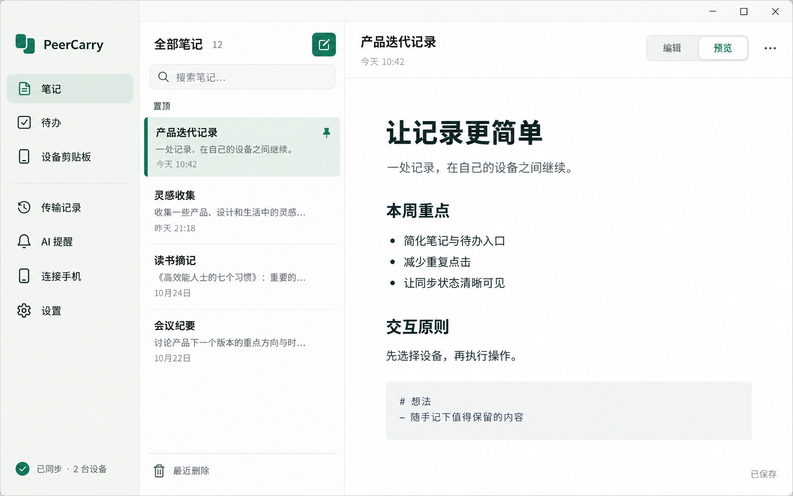
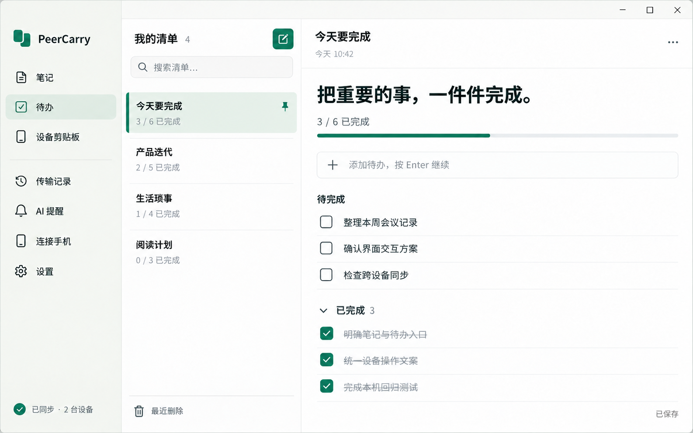
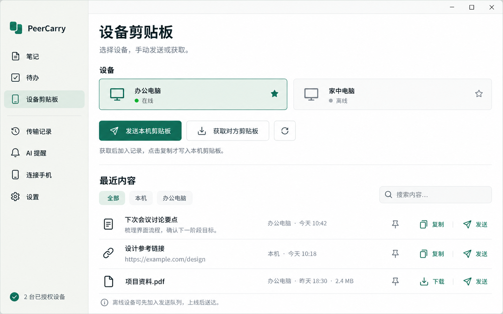

# PeerCarry 笔记本界面视觉稿

本套设计已应用到软件界面。实现范围、实际截图和验证边界见 [设计落地记录](implementation.md)。下文保留视觉稿阶段的设计说明。

日期：2026-10-29。按现有 Markdown 笔记、Todo 和设备剪贴板功能，用内置 imagegen 生成三页一致的桌面视觉稿。此目录为设计交付，产品 HTML/CSS、数据/API、安装版及 Git 提交状态未因此改变。

## 设计稿

| 页面 | 文件 | 主要设计 |
| --- | --- | --- |
| 笔记 | [01-notes.png](01-notes.png) | 导航、笔记列表、正文三栏；置顶和回收等次要操作收进菜单；编辑/预览切换集中在正文工具栏 |
| 待办 | [02-todo.png](02-todo.png) | 清单列表与当前任务分栏；单行新增并支持 Enter 连续录入；完成数量、勾选和已完成分组清晰可见 |
| 设备剪贴板 | [03-device-clipboard.png](03-device-clipboard.png) | 先选设备再发送/获取；在线、离线和收藏状态明确；历史条目只突出复制、发送或按需下载 |

## 共同样式与交互边界

- 沿用暖白背景、白色内容区、青绿色主操作、浅绿选中态，以及系统中文字体与一致的线性图标。
- 借鉴苹果备忘录的清晰分栏和内容层级，保留 Windows 窗口控件与 PeerCarry 品牌。
- 左侧主导航固定为笔记、待办、设备剪贴板；传输记录、AI 提醒、连接手机和设置作为次级入口。
- 笔记页展示 Markdown 预览状态；切换编辑后使用现有 Markdown 编辑能力。没有引入富文本编辑器或实时协作光标。
- 待办以命名清单、任务文本和勾选为基础；不扩展日期、提醒、日历或优先级等业务模型。
- 设备选择只改变操作目标。获取对方剪贴板后加入记录，仍需用户明确点击复制才改写本机剪贴板；文件继续按需下载。
- 图中的已同步、授权设备数量、在线状态及笔记内容均为示例，不代表当前设备环境的实际状态。同步和授权入口需在实现阶段与现有数据状态完整对接。
- 设备页承接工作台的选设备、发送和获取动作；落地时补齐文件发送等现有能力的入口映射，保留原功能可达性。

## 交付与后续落地

三张 PNG 已逐张检查主要中文文案、选中状态、完成数量和手动剪贴板语义；均为同一尺寸和样式的概念图。它们没有替代真实浏览器或原生客户端验收。

后续实现可复用现有 HTML/CSS/JavaScript 和 SVG 图标：调整列表密度、工具栏、任务分组和设备页层级，再验证窄窗口、键盘/输入法、自动保存及同步状态。此轮仅交付设计。

完整生成/编辑提示词见 [prompts.md](prompts.md)，图片尺寸和 SHA-256 见 [assets.json](assets.json)。原始生成结果已复制到本目录，保留原文件未覆盖。
