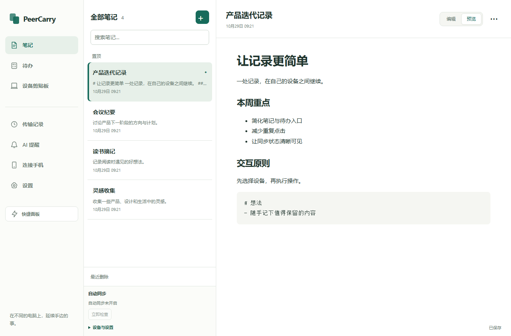
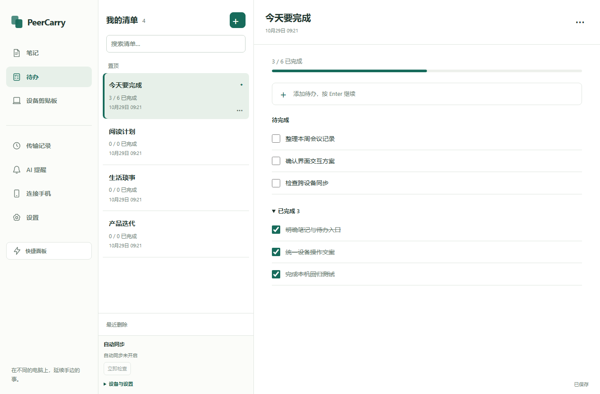
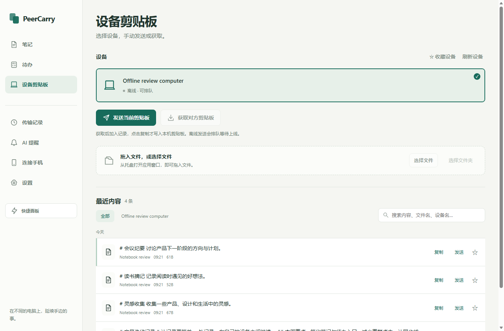

# 设计落地记录

日期：2026-10-29。实现依据为本目录三张视觉稿；下方截图来自软件实际页面，使用隔离的合成数据。

## 已应用的界面

- 笔记与待办改为侧边导航、内容列表、编辑区三栏工作区。窄窗口切换为列表与正文单栏，保留编辑草稿。
- 笔记提供同一位置的编辑/预览切换；保存、导出、发送放进更多菜单，列表中的置顶、回收也收进菜单。
- 待办显示完成进度，分开呈现待完成和已完成任务；输入后按 Enter 连续添加，兼容输入法组合输入。离开清单时也保存尚未提交的输入；保存失败继续保留内容并阻止离开。
- 设备剪贴板承接原工作台的发送、获取、文件选择和历史操作。历史可按所选设备筛选，键盘与条目操作继续引用原始条目 ID。旧工作台入口映射到同一页。
- 设置、传输记录、AI 提醒、连接手机和快捷面板统一使用暖白背景、白色内容区、青绿主操作与一致的表单/状态样式。短窗口将次要导航收进更多菜单。
- 手机端通过现有 `CarryColors` 和 `CarryRadii` 公共主题对齐配色、控件和卡片圆角，保留移动端触控尺寸及原页面结构。

桌面公共样式在 `crates/peercarry-core/desktop-theme.css`，由本机服务嵌入。手机端主题在 `apps/mobile/lib/app_theme.dart`。无外部字体或图标依赖。

## 行为与边界

选择设备不会触发发送或获取；获取只加入历史，仍需点击复制才写入本机剪贴板。文件仍按需传输，原有原生文件选择入口保留。同步状态读取真实接口，不展示设计稿中的示例在线数量或已同步状态。

复核时发现配置网络令牌后手机管理页返回 HTTP 401，已将明确的本机手机管理路径纳入现有桌面访问判定；仍经过回环地址、Host/Origin/Fetch-Site 以及手机管理路由自身的本机限制，未把令牌注入前端。

## 验证

- JavaScript：107 项通过，含新增待办输入、分组、草稿保留、设备筛选后键盘/复制/发送条目 ID 和紧凑导航回归。
- Flutter：`flutter analyze --no-pub` 无问题；现有 widget 与 vault 页面测试 13 项通过。
- Rust 格式：`cargo fmt --all -- --check` 通过。
- 实际浏览器：7 组 Edge 检查通过，包含 5 组主界面、2 组快捷面板。主界面每组检查笔记、待办、设备剪贴板、传输记录、AI 提醒、连接手机、设置共 7 页。尺寸为 1366×900、940×680、560×420、390×760，覆盖中英文；快捷面板为 390×590 与 340×420。所有页面均检查横向溢出与公共主题加载，并实际操作待办输入/勾选/导航保存及菜单。
- 核心回归：`cargo test -p peercarry-core --offline`，93 项通过、0 失败、0 忽略，含新增桌面资产/手机管理本机访问边界测试。
- Windows 开发构建：CLI 与托盘均通过；另逐字节确认两份可执行文件嵌入的 HTML、JS、CSS 与本轮最终源码一致。保留既有编译告警；本轮没有制作安装包或替换现有安装版。

Luna 子代理完成快捷面板及手机端公共主题调整，并另行进行只读复核。主会话检查实际差异，负责主界面实现、集成、浏览器输入验证与最终回归。

浏览器使用独立服务与数据目录，测试结束后服务及浏览器进程已停止。未进行真实剪贴板写入、真实设备配对或 Tailnet 传输。手机连接页确认可读取本机状态；实际手机扫码、同步、原生托盘/WebView 和已安装版本仍需独立验收。AI 页本轮覆盖隔离环境下的空态/工具扫描失败态呈现，不代表真实 AI 工具接入通过。

## 实际界面截图

最终截图与 [校验清单](implemented/checks.json) 在 `implemented/`，记录代码和图片 SHA-256、尺寸及验证范围。

其他页面：[设置](implemented/settings.png)、[手机连接](implemented/phone-connection.png)、[快捷面板](implemented/quick-panel.png)。

紧凑布局：[笔记](implemented/notes-compact.png)、[待办](implemented/todo-compact.png)、[更多菜单](implemented/navigation-compact.png)、[英文快捷面板](implemented/quick-panel-compact.png)。
