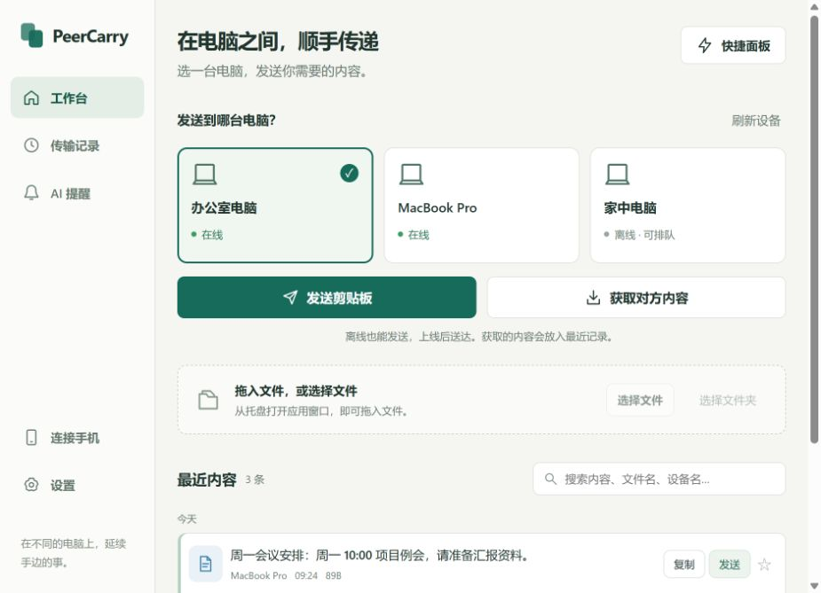
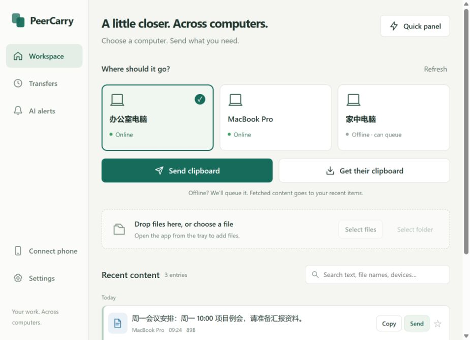
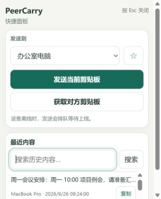
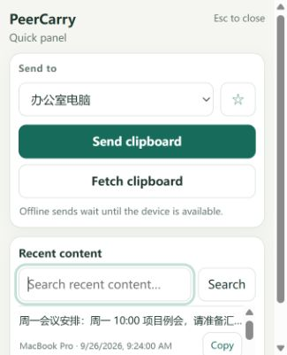

# 桌面中英文自动适配

桌面端不需要手动选择语言。启动时读取电脑的首选显示语言，中文语言族显示简体中文，其余语言显示英文；托盘、工作台、快捷面板、AI 提醒、传输中心和设置共用同一结果。页面日期和辅助标签也使用对应语言。设备名称、剪贴板正文、文件名与原始诊断详情保留原文。

Windows 使用用户首选 UI 语言接口，不再把地区格式误当成显示语言；macOS 读取 `NSLocale.preferredLanguages` 的第一项。Linux 按消息语言环境变量识别首选语言，包含 `LANGUAGE` 列表和 `LC_ALL`、`LC_MESSAGES`、`LANG` 的优先关系；C/POSIX 语言环境使用英文。环境变量语义参考 [GNU gettext 文档](https://www.gnu.org/software/gettext/manual/html_node/The-LANGUAGE-variable.html)。

系统语言修改后，完全退出并重新启动 PeerCarry 生效。原有 `PEERCARRY_LANG=zh` / `en` 诊断覆盖仍可使用。单独从浏览器访问本机页面时，跟随浏览器的第一首选语言；原生窗口始终使用电脑语言，不受浏览器语言影响。

## 本次验证（2026-09-26）

- Windows 语言模块 6 项测试通过，包含实际读取 Windows UI 语言接口；托盘和 CLI 开发版构建通过。
- Linux 在已有 WSL Ubuntu 中直接编译同一语言模块，5 项测试通过。此结果不代表 Linux 托盘或 Wayland 窗口实机验收。
- 前端 23 项测试通过，覆盖原生中文/浏览器英文、原生英文/浏览器中文、中文变体、非中文回退、首选语言、文案、日期及原有显式发送/复制流程。
- 桌面接口回归通过：新增语言脚本在本机可加载，认证后的网络对端仍无法访问该本机资源；跨来源控制仍被拒绝。
- `cargo fmt --all -- --check` 通过。Windows 构建保留原有 `unused_mut` 告警，无新增编译错误。
- 浏览器只读合成页面验证了中英文工作台（940 × 680）及快捷面板（340 × 420），后者两种语言均无横向溢出；只模拟原生语言注入，未更改系统或浏览器语言，未操作真实剪贴板。

macOS 未进行本机编译或真机验证。Windows 原生窗口启动及系统切换后的端到端体验仍需安装后验收；此次没有替换现有安装版本。

## 验证入口

```text
cargo test -p peercarry-tray i18n --locked --offline
cargo test -p peercarry-core --test desktop_tools --locked --offline
cargo build -p peercarry-tray -p peercarry-cli --locked --offline
cargo fmt --all -- --check
node scripts/tests/ui-locale.test.cjs
node scripts/tests/quick-panel.test.cjs
node scripts/tests/transfer-center.test.cjs
node scripts/tests/workbench.test.cjs
```

当前沙箱内 `node --test` 的子进程启动受到限制，直接运行上述测试文件可完成相同断言。

截图：

| 中文 | 英文 |
| --- | --- |
|  |  |
|  |  |
